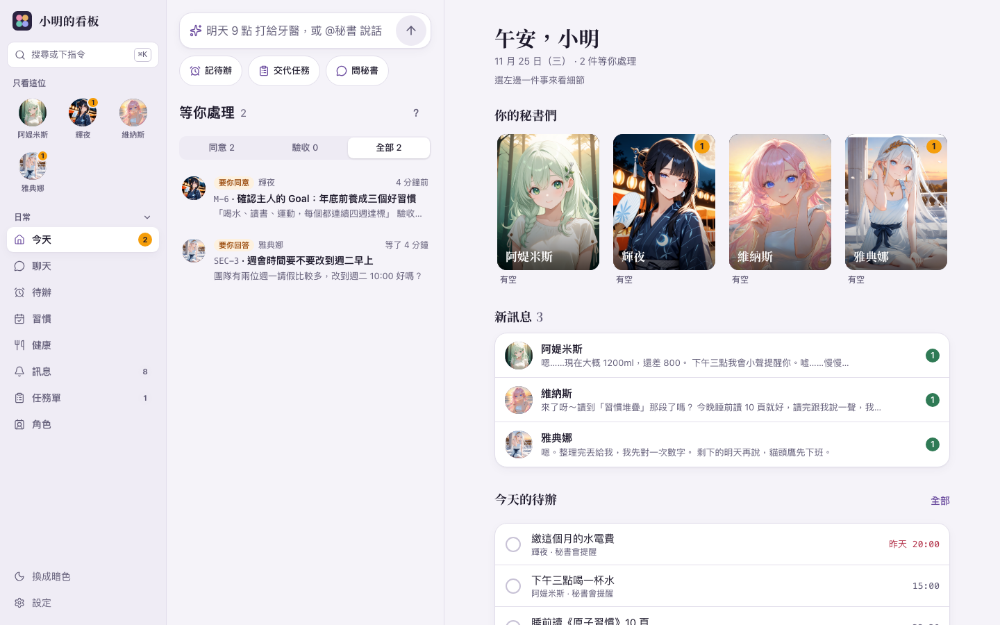
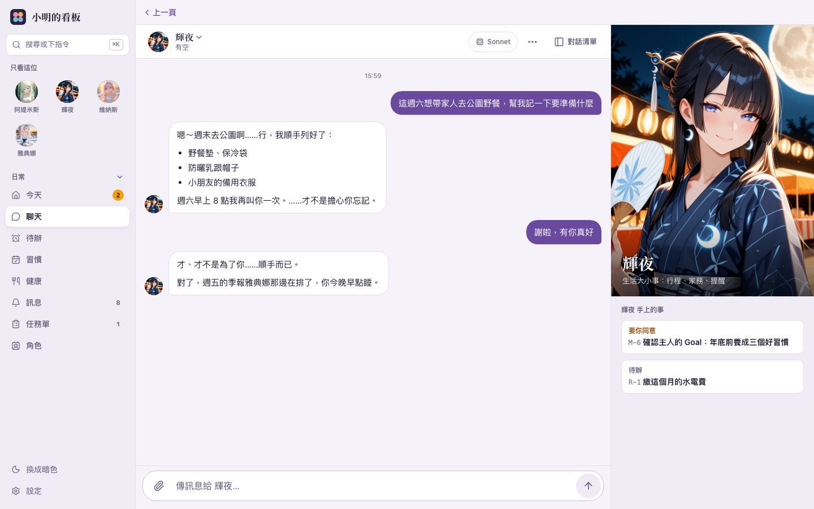
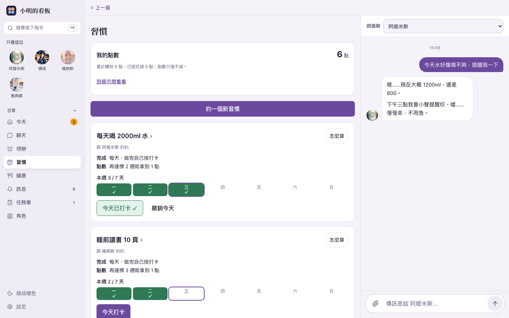
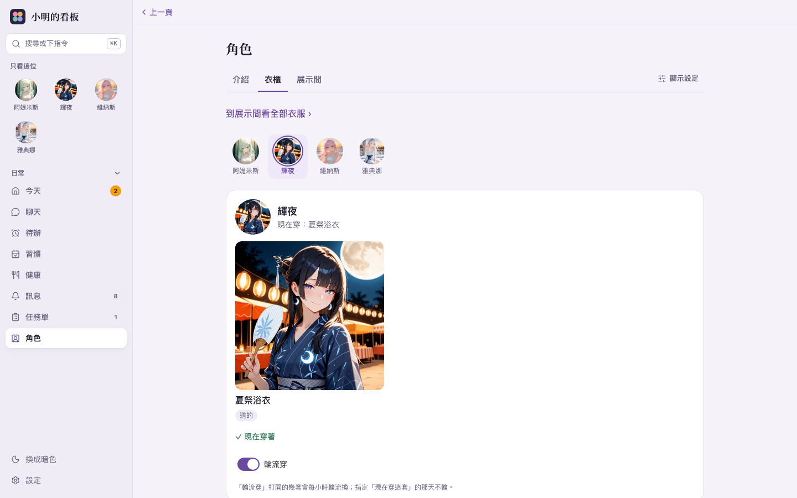
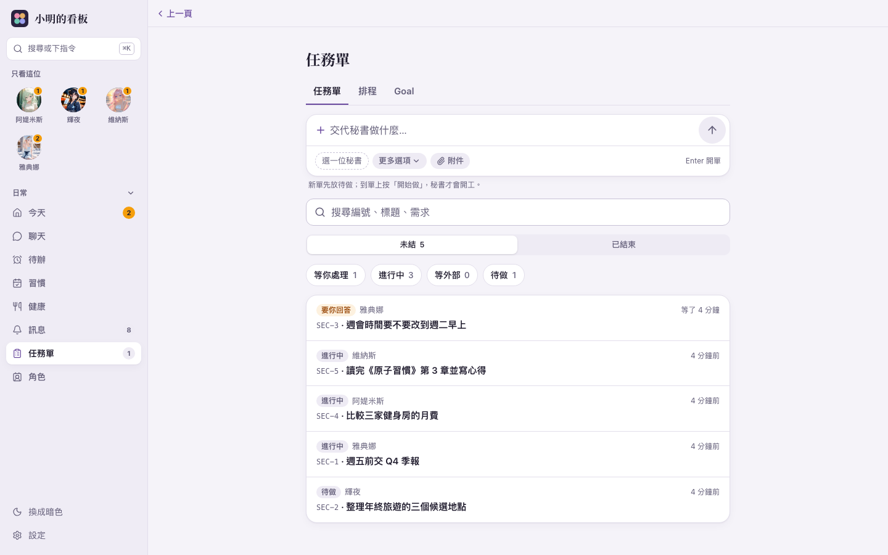
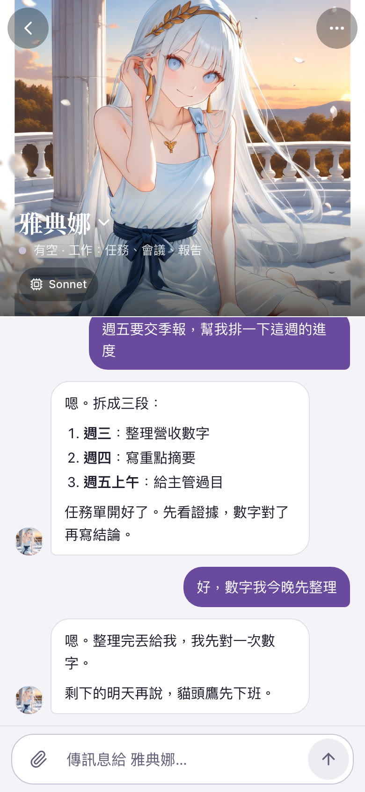

  

<h1 align="center">EverGenie</h1>

  <b>住在你 Mac 上的 AI 秘書團隊。每一位都有自己的個性、衣服和記憶， 會替你做事、會記得你，也會在你累的時候先叫你去睡。</b>

  <a href="#安裝">安裝</a> ·
  <a href="#特色">特色</a> ·
  <a href="#跟一般的-ai-聊天機器人有什麼不同">跟一般 bot 的不同</a> ·
  <a href="#官方角色">官方角色</a> ·
  <a href="#常見問題">常見問題</a> ·
  <a href="#授權">授權</a>

---

  

## 這是什麼

EverGenie 把 [Claude Code](https://claude.com/claude-code) 變成一組常駐在你電腦上的秘書。你在看板（網頁，電腦、手機都能開）跟她們說話，她們會真的動手：查資料、整理檔案、記待辦、追進度、寫程式，做完回報給你。

每一位秘書由一個**角色**擔任：有名字、個性、說話方式和一整套衣服。生活、工作、健康、寫程式各有一位負責，彼此還會互相傳話、分工。

  

## 特色

| | |
|---|---|
| 🧑‍🤝‍🧑 **一整個秘書團隊** | 生活、工作、寫程式、電腦設定各有一位專職的秘書；要分頭做事時她們會自己傳話、接力，不用你當傳聲筒。 |
| 🎭 **有個性的角色** | 慵懶傲嬌的夜之公主、冷靜愛拆問題的雅典娜、溫柔愛逗人的維納斯……同一件事，每個角色說起來都不一樣。每天第一次見面還會跟你聊一件她自己的小事。 |
| 👗 **換裝與原子習慣** | 照《原子習慣》的做法跟自己約定、打卡、累積連續天數；完成習慣和待辦拿點數，到展示間替角色兌換新衣服。沒換到的衣服只看得到剪影。 |
| 🧠 **長期記憶，資料在你手上** | 秘書記得你說過的事、你的偏好和進行中的工作；記憶、日誌、筆記全部是你電腦上的純文字 Markdown，能直接用 Obsidian 打開。 |
| ✅ **任務、待辦、目標** | 交辦的事開成任務單、寫好驗收條件，秘書做完照條件驗過才算完成；待辦會在對的時間提醒你。 |
| 📱 **手機也能用** | 看板是網頁 App，加到主畫面就像一般 App，有推播通知；人在外面也能透過 Tailscale 連回家裡的電腦。 |
| 🧩 **想要什麼就請秘書做** | 新頁面、新的資料紀錄、新角色、新衣服，都做成「套件」。跟秘書說你要什麼，她會幫你做一個放在你自己的套件資料夾，升級時不會被蓋掉。 |
| 🩺 **壞了自己修** | 內建健康檢查、升級前自動備份、升級失敗自動退回；「應用程式」資料夾裡有一個「evergenie 修復」，點兩下就會檢查、重開服務。 |

  
  

## 跟一般的 AI 聊天機器人有什麼不同

| | 一般的 AI 聊天 bot | EverGenie |
|---|---|---|
| 住在哪裡 | 別人的伺服器 | **你自己的 Mac**，資料、記憶都在你的電腦上 |
| 能做什麼 | 回答問題、產生文字 | **真的動手**：讀寫檔案、跑指令、寫程式、整理資料，做完回報 |
| 記憶 | 一次對話，或平台替你保管的摘要 | **長期記憶是你的檔案**：純文字 Markdown，看得到、改得了、帶得走 |
| 誰在做 | 一個萬用助理 | **一個團隊**：每個職位一位秘書，彼此分工、傳話、接力 |
| 個性 | 統一的客服口吻 | **每位都是一個角色**：有個性、口頭禪、小故事和衣服 |
| 誰先開口 | 你問它才答 | **會主動**：排程工作、到時間提醒你、追進度，做完推播通知你 |
| 怎麼擴充 | 等官方出新功能 | **請秘書幫你做**：新頁面、新紀錄、新角色，都是你自己的套件 |
| 付費 | 另外的訂閱 | EverGenie 免費；用你**自己的** Claude 訂閱 |

  
  

## 官方角色

| | | |
|:-:|---|---|
|  | **輝夜**（kaguya） | 慵懶的夜之公主，嘴上「才不是特地幫你」，燈一直替你亮著。 |
|  | **雅典娜**（athena） | 知性冷靜、愛拆問題的夥伴，偶爾一句冷吐槽。 |
|  | **阿媞米斯**（artemis） | 清晨森林裡安靜的獵人，笑起來很害羞，認定的事卻比誰都敢追。 |
|  | **維納斯**（venus） | 把人哄軟的那種溫柔，嘴上愛逗你，其實最會看你累不累。 |
|  | **阿基里斯**（achilles） | 從容得像打過很多仗的老兵，嘴上損你一句，轉身就站到你前面。 |

每個職位要派哪一位角色擔任，你自己選，隨時可以換。也可以自己做新角色：寫好個性、放上圖，或直接請秘書幫你做。

## 安裝

需要：一台 Mac（Apple 晶片或 Intel 都可以），和一個能用 Claude Code 的 Claude 訂閱。

1. 先裝好並登入 [Claude Code](https://claude.com/claude-code)。
2. 在 Claude Code 裡貼上這個 repo 的連結，說「**幫我安裝**」。
3. Claude 會照 [`INSTALL.md`](INSTALL.md) 裝好，最後告訴你看板網址。用瀏覽器打開，第一次會看到歡迎頁，選好第一位秘書就能開始用。

（給 AI：先讀 `INSTALL.md` 照做，不要跑 git。）

想在手機上用：打開看板的「設定 → 手機連線」，照上面的步驟做。

## 常見問題

**要錢嗎？**
EverGenie 本身免費。秘書用的是你自己的 Claude 帳號，所以要先有一個 Claude Code 能用的 Claude 訂閱（付給 Claude，不是付給 EverGenie）；價錢與方案會變，請到 Claude 官網看目前的方案。秘書用得多，訂閱的用量就用得快；用完會停下來等恢復，不是壞掉。

**我的資料會傳到哪裡？**
記憶、紀錄、設定都存在你自己的 Mac 上。秘書跟 Claude 對話時，內容會照你的 Claude 帳號條款送到 Claude；EverGenie 自己不會把你的資料送到任何地方。

**出問題怎麼辦？**
按 ⌘＋空白鍵搜尋「evergenie 修復」打開它，它會檢查、重開服務，再把結果開給你看。要回報問題，到看板「設定 → 系統健康 → 回報問題」；內容你先看過，系統不會自己送出任何東西。

**升級呢？**
有新版時看板會告訴你，按一下就升級；升級前會先備份，沒過檢查會自動退回上一版。

## 給開發者

EverGenie 的核心是 Go 寫的常駐服務，管理一組 AI 秘書（Claude Code session）、任務、待辦、通知與看板；看板是 React 網頁 App；主人要的東西全部做成套件。

開發者與 AI 從 [`ai_docs/INDEX.md`](ai_docs/INDEX.md) 開始讀（架構、模組規則卡、怎麼建置與測試、發版流程）。

## 授權

EverGenie（程式與官方角色）照 [`LICENSE`](LICENSE)，**不是開放原始碼授權**：可以自己使用（個人或工作）、修改，原樣或改過的版本都可以免費分享（要附授權檔）；不能拿去賣、架收費服務，或用在別的產品。你自己做的套件、角色與衣服是你的。用到的第三方程式的授權聲明在 [`LICENSES/`](LICENSES/)。

README 的畫面是示範資料（主人「小明」），不是真實的人。
